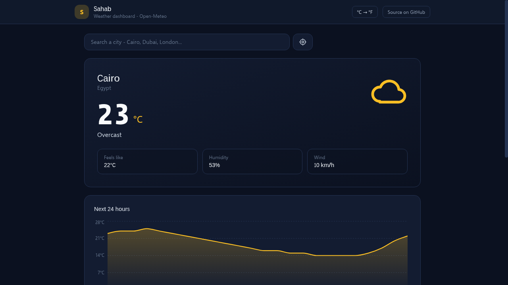

# Sahab - Weather Dashboard

A weather dashboard powered by the free Open-Meteo API (no API key required): search any city with autocomplete, use your geolocation, and see current conditions, a 24-hour temperature curve and a 7-day forecast.

> **Live demo:** https://sahab-weather-six.vercel.app
>
> All data shown is live from Open-Meteo - no demo data, no mock backend.



## Features

- **City search with autocomplete** (Open-Meteo geocoding, debounced)
- **Geolocation** one-tap current position weather
- **Current conditions**: temperature, feels-like, humidity, wind, condition icon (day/night aware)
- **24-hour temperature chart** (Recharts) with rain probability in tooltips
- **7-day forecast** with min/max temperature range bars (week-scaled), rain chance, sunrise/sunset
- **°C / °F toggle** (metric/imperial, persisted) and last city remembered in localStorage
- **Resilient states**: loading, error and empty states handled
- **7 unit tests** over the response-mapping layer (WMO codes, hourly slicing, daily mapping, unit labels)

## Tech stack

| Layer  | Tech |
|--------|------|
| UI     | React 18, Vite, Tailwind CSS, Recharts |
| Data   | Open-Meteo forecast + geocoding APIs (client-side fetch, no key) |
| Tests  | node:test over a pure mapping module |
| Deploy | Vercel (static) |

## Run locally

```bash
npm install
npm run dev      # on :5174
npm test         # 7 mapping tests
npm run build    # production build
```

## Notes

- WMO weather codes are mapped to labels and stroke icons in `src/lib/weather.js`, a pure module so it is fully unit-testable.
- Hourly chart starts at the current hour in the place's own timezone (`timezone=auto`).
